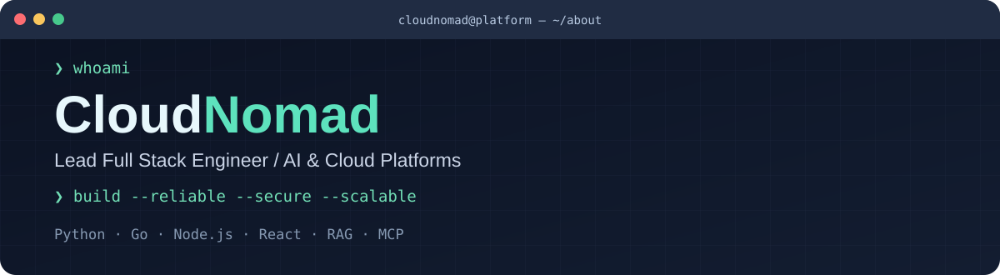
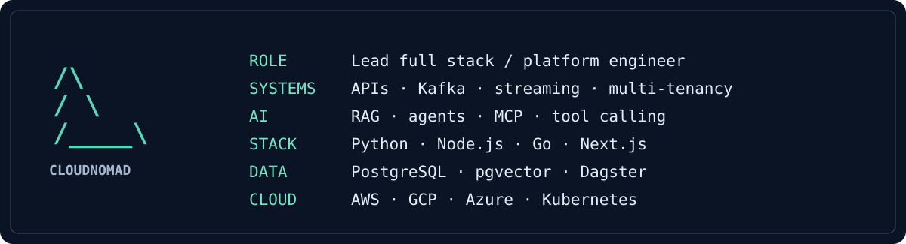
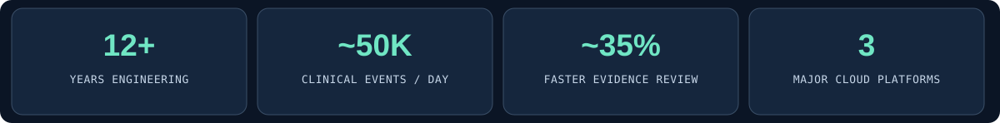

<a id="top"></a>

<picture>
  <source media="(max-width: 700px)" srcset="assets/terminal-hero-compact.svg" />
  
</picture>

<picture>
  <source media="(max-width: 700px)" srcset="assets/platform-fetch-compact.svg" />
  
</picture>

<p align="center">
  
  
  
</p>

---

### `$ cat /etc/cloudnomad/about`

**CloudNomad** is a lead full stack engineering identity focused on **secure AI platforms, distributed backend services, and cloud architecture**. With **12+ years** of experience across healthcare, enterprise software, and applied AI, I build systems where data integrity, platform reliability, and thoughtful product engineering matter.

```bash
$ engineer --capabilities
> LLM gateways / RAG / AI agents / MCP tool servers
> Multi-tenant platform design / OAuth2 / OIDC / RBAC
> Event-driven APIs / Kafka / WebSockets / SSE
> React / Next.js / FastAPI / Go / Node.js
> AWS / GCP / Azure / Terraform / Kubernetes
```

### `$ platform --telemetry`



*Numbers represent selected professional outcomes and experience, not GitHub contribution counts.*

---

### `$ ls ./specialties`

| Module | What it covers |
| :--- | :--- |
| `agents/` | RAG over curated knowledge, structured LLM output, tool calling, MCP servers |
| `platform/` | Multi-tenant isolation, OIDC SSO, organization RBAC, REST APIs & SDKs |
| `events/` | Kafka services, idempotent consumers, near-real-time reporting, WebSockets & SSE |
| `data/` | PostgreSQL, pgvector, Dagster, Airflow, BigQuery, Databricks |
| `cloud/` | AWS EKS/ECS/Lambda, GCP, Azure, Docker, Terraform, AWS CDK |
| `quality/` | Audit logging, SOC 2 / HIPAA practices, Playwright, Jest, performance tuning |

### `$ cat ~/engineering-highlights.log`

- **Enterprise AI workspaces** — designed research workflows, retrieval and secure tool execution over large scientific datasets.
- **Realtime collaboration** — streamed model responses over SSE and shared workspace state over WebSockets.
- **Clinical event systems** — developed Go consumers handling approximately 50K daily events with failure recovery.
- **Data pipelines** — established schema-checked transfers into PostgreSQL / pgvector and analytics warehouses.
- **Secure infrastructure** — multi-tenant access controls, audit trails, secrets management, and infrastructure as code.

---

### `$ systemctl status engineering-principles`

```text
● engineering-principles.service  — active (running)
  Architecture  : Small interfaces, clear ownership
  Reliability   : Idempotency, observability, graceful recovery
  Security      : Least privilege, tenant isolation, auditability
  UX            : Fast, accessible, predictable interactions
  Delivery      : Automated tests, reviews, reproducible deploys
```

<!-- Optional GitHub metrics after you have created the matching account.
<p align="center">
  
</p>
-->

<p align="center"><sub>cloudnomad@platform:~$ _</sub></p>
<p align="right"><a href="#top">↑ return to top</a></p>
